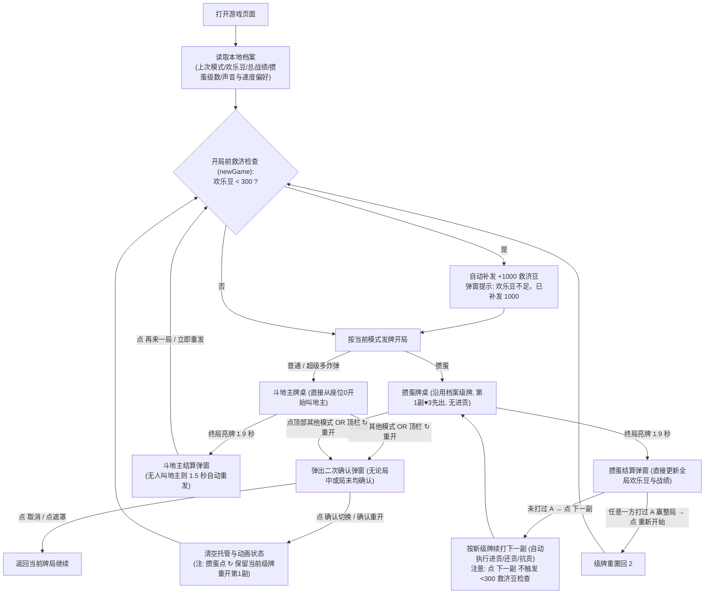
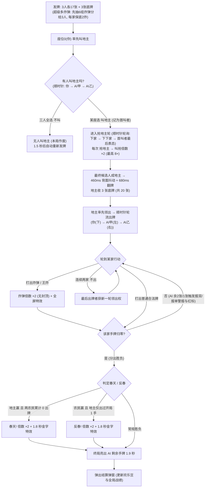
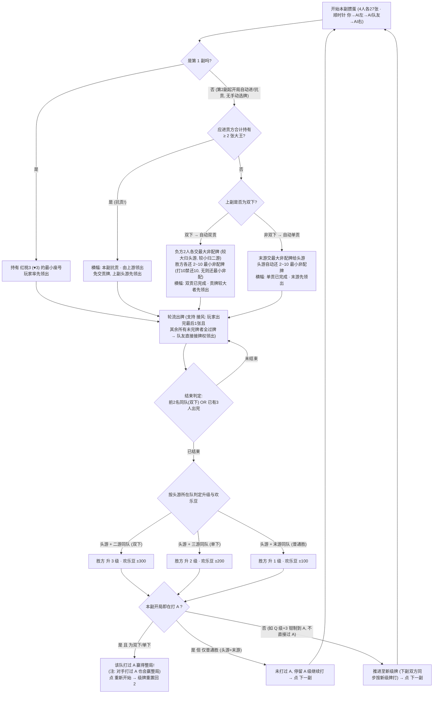
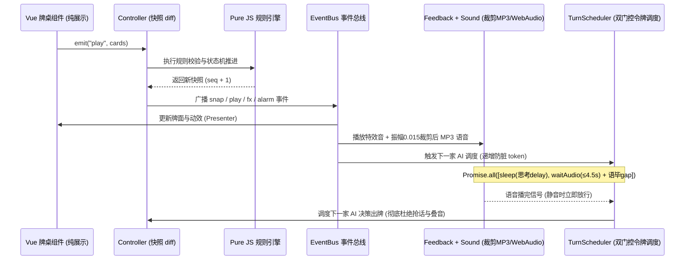

# 《家庭斗地主》玩家使用手册（含普通模式 / 超级多炸弹 / 4 人掼蛋）

> **对应仓库**：[`GYC-Debug-create/doudizhu`](https://github.com/GYC-Debug-create/doudizhu)  
> **适用对象**：家庭休闲玩家、棋牌爱好者，以及关注事件驱动架构与跨端交互细节的体验者/评审者  
> **文档定位**：本手册依据 **ISO/IEC/IEEE 26514** 与 **GB/T 8567-2006（软件用户手册）** 规范编写，经**双轮独立源码交叉审查**核实，完整覆盖 3 大模式、全界面按钮与 Toast 提示、全部规则分支、AI 队友配合逻辑、实战算分演练及工程架构亮点。安装与构建命令请参阅仓库根目录的 `README.md`。

---

## 目录

1. [游戏简介、座位拓扑与三大模式速览](#一游戏简介座位拓扑与三大模式速览)
2. [全局交互、模式切换与救济豆流程图](#二全局交互模式切换与救济豆流程图)
3. [全界面与按钮操作后果表（含全部提示文案）](#三全界面与按钮操作后果表含全部提示文案)
4. [斗地主完整流程、规则与算分演练（普通与超级多炸弹）](#四斗地主完整流程规则与算分演练普通与超级多炸弹)
5. [掼蛋完整流程、规则与逢人配演练（4 人 108 张 2v2）](#五掼蛋完整流程规则与逢人配演练4-人-108-张-2v2)
6. [AI 队友配合策略、手势快捷键、记牌器与语音特效](#六ai-队友配合策略手势快捷键记牌器与语音特效)
7. [本地存档、多端适配与常见问题 FAQ](#七本地存档多端适配与常见问题-faq)
8. [工程落地与用户体验设计亮点（含事件同步时序图）](#八工程落地与用户体验设计亮点含事件同步时序图)

---

## 一、游戏简介、座位拓扑与三大模式速览

**《家庭斗地主》** 是一款纯本地离线运行的 H5 / 微信小程序棋牌游戏，**无广告、无氪金、无需联网**，打开页面即按上次模式直接发牌开局（无独立大厅页）。

| 模式 | 人数与牌数 | 核心特色 | 战绩与钱包 |
| :--- | :--- | :--- | :--- |
| **♠ 普通模式** | 3 人 · 54 张（1v2） | 标准斗地主，叫/抢地主、炸弹翻倍、春天/反春 ×2、记牌器、托管、快捷键 | 三模式全局共享同一份**欢乐豆余额**与顶栏**总战绩 / 连胜** |
| **✦ 超级多炸弹** | 3 人 · 54 张（1v2） | 发牌保底**每家至少 2 组炸弹**，另有概率再凑额外炸弹/王炸，倍数狂飙 | 同上 |
| **♣ 掼蛋** | 4 人 · 108 张（2v2） | 你 + 对家 AI 联手打级（从 2 打到过 A），含**红桃级牌“逢人配”**、同花顺、接风、自动进贡/还贡/抗贡 | 升级奖励（`±100/±200/±300`）直接结算到全局欢乐豆与战绩 |

- **顺时针座位拓扑（两种模式均为顺时针轮转）**：
  - **斗地主**：`你（下，座 0） → AI·甲（左，座 1） → AI·乙（右，座 2） → 你`
  - **掼蛋**：`你（下，座 0，我方） → AI·左（左，座 1，对手） → AI·队友（上，座 2，我方） → AI·右（右，座 3，对手） → 你`

---

## 二、全局交互、模式切换与救济豆流程图

---

## 三、全界面与按钮操作后果表（含全部提示文案）

### 3.1 顶部工具栏与模式切换条

| 界面元素 / 按钮 | 显示范围 | 点击后的精确后果与提示 |
| :--- | :--- | :--- |
| **模式标签**（`普通模式` / `超级多炸弹` / `掼蛋`） | 全局顶栏下方 | 点当前已选模式无响应；点其他模式必弹二次确认框，确认后丢弃当前进度并按新模式发牌（切回掼蛋续用上次保存的级牌）。 |
| **本局倍数 / 当前级牌** | 顶栏中部 | 斗地主实时显示 `叫抢倍数 × 炸弹倍数`（春天/反春 `×2` 仅在终局结算时叠加）；掼蛋显示当前级牌与 `♥ 红桃X配牌` 提示。 |
| **底牌展示区** | 仅斗地主顶栏 | 叫抢期显示 3 张牌背；定地主后进入 **1.14 秒两段揭示**：先 `460ms` 背面抖动（此时若你是地主，手牌区**暂隐这 3 张底牌**且暂停 AI 与记牌器），再 `680ms` 依次翻面公开，随后底牌正式并入手牌。 |
| **战绩胶囊** | 屏幕宽度 `> 760px` | 显示三模式合计胜负；连胜 `≥ 2` 亮出橙色 `{N}连胜`；鼠标悬停显示胜率。*（纯展示，无清零按钮。）* |
| **声音开关** (`🔊` / `🔇`) | 全局顶栏右侧 | 开关音效与语音并存盘；关闭立即静音并放行 AI 回合等待；开启播放一声提示音。 |
| **AI 速度** (`慢` / `中` / `快`) | 全局顶栏右侧 | 循环切换并弹 Toast `AI 出牌速度：{慢/中/快}`： • **慢**：思考 `1350ms` + 语毕停顿 `450ms` • **中（默认）**：思考 `850ms` + 语毕停顿 `260ms` • **快**：思考 `420ms` + 语毕停顿 `120ms` |
| **记牌器开关** (`记`) | **仅斗地主显示** | 切换是否展示剩余牌统计条（默认开启）并存盘。 |
| **重新开始** (`↻`) | 全局顶栏最右 | 弹确认框，确认后丢弃本局重发并触发低欢乐豆救济检查；**在掼蛋中点此按钮会保留当前级牌**（重开第 1 副），不会退回打 2。 |

### 3.2 斗地主操作区按钮（`ActionBar` + 手牌反馈区）

> 中央舞台会持续保留最近 **8 条「叫抢记录」气泡**；底部左侧显示全局欢乐豆余额，中间带状态灯实时判牌，右侧选牌后出现 `清空` 按钮。

| 当前局面 | 按钮 | 何时禁用 | 点击后果与完整 Toast 提示 |
| :--- | :--- | :--- | :--- |
| **叫地主轮** | `♛ 叫地主` / `× 不叫` | 均可用 | 点手牌弹 Toast `叫地主阶段不能选牌`；三人全选「不叫」流局并 `1.5 秒` 自动重发（Toast `无人叫地主，重新发牌`）。 |
| **抢地主轮** | `♛ 抢地主` / `× 不抢` | 均可用 | 选「抢地主」叫抢倍数 **×2** 并暂定地主归你；防御分支 `robPassOnly` 仅显 `× 不抢`。 |
| **出牌 · 无牌可压** | 仅显示 `→ 要不起` | 可用 | 直接过牌让出牌权（隐藏提示/出牌/托管按钮）。 |
| **出牌 · 可跟/领出** | `✦ 提示` | 始终可用 | 同一手内**连续点击循环切换所有合法方案**（首推 AI 最优解，后续按拆牌代价递增轮换），弹 Toast `建议：{牌型名}`；无牌可压弹 `没有牌大过上家`。 |
| **出牌 · 可跟/领出** | `→ 不出` | 领出轮置灰 | 过牌；领出轮强行触发弹 Toast `新一轮必须出牌`。 |
| **出牌 · 可跟/领出** | `▶ 出牌` | 选牌非法或压不过上家时置灰 | 打出选中牌；非法触发时依原因提示：`请先选择要出的牌` / `牌型不成型，请调整选牌` / `需同为 {上家牌型} 或用炸弹压过` / `点数不够大，压不过上家`。 |
| **出牌轮 / 等 AI 出牌** | `🤖 托管` / `取消托管` | **仅斗地主出牌阶段显示**（叫抢期不可开启） | 开启弹 Toast `已托管，AI 帮你出牌`（AI 代你出牌且思考上限压至 `600ms`，同时禁用快捷键与 18 秒催牌）；随时可点「取消托管」恢复手动（Toast `已取消托管`）；每局开局自动重置关闭。 |
| **已选牌** | `清空` | 未选牌时隐藏 | 一键取消所有选牌。 |

### 3.3 掼蛋操作区按钮（轮到本家出牌时显示）

> 掼蛋**无记牌器、无托管、无键盘快捷键**；非本家回合点击手牌会弹 Toast `未轮到你出牌`（斗地主出牌期等 AI 点手牌则静默忽略）。手牌自动按级牌价值降序排列，红桃级牌带 **`配`** 角标；打出至少一手后手牌上方展示 `你的上一手`。

| 按钮 | 何时禁用 | 点击后的精确后果与提示 |
| :--- | :--- | :--- |
| `✦ 提示` | 始终可用 | **基于已选牌智能补全（非循环切换）**：若你先点了 1~N 张牌，系统优先按「四王 → **用已选非配牌点数从大到小凑最大 4~10 炸** → 其他炸弹 → 同花顺 → 飞机 → 钢板 → 三带二 → 三连对 → 顺子 → 三张 → 对子 → 单张」帮你补全合法方案；找不到才回退 AI 全局推荐，弹 `建议：{牌型名/N炸/四王}`。若队友正持牌权且你未选牌，AI 建议让队友走并弹 `当前牌权下建议不出`！ |
| `→ 不出` | 领出轮置灰 | 过牌让给下家（领出轮强行触发弹 `新一轮必须出牌`）。 |
| `▶ 出牌` | 非法或压不过上家时置灰 | 打出选中牌（红桃配牌自动按最高牌力合法牌型解析）；底部反馈栏实时给出 4 类原因：`未轮到你` / `请先选择要出的牌` / `牌型不成型，请调整选牌` / `牌型不匹配或压不过上家`。 |
| `清空` | 未选牌时隐藏 | 取消所有已选牌。 |

---

## 四、斗地主完整流程、规则与算分演练（普通与超级多炸弹）

### 4.1 斗地主全流程与分支状态图

### 4.2 斗地主 12 种合法牌型与计分公式

点数大小：`3 < 4 < 5 < 6 < 7 < 8 < 9 < 10 < J < Q < K < A < 2 < 小王 < 大王`。

- **全部 12 种合法牌型**：单张、对子、三张、三带一、三带二、顺子（`≥5` 张连续单张，最高到 `A`）、连对（`≥3` 对连续对子，最高到 `A`）、飞机不带（`≥2` 组连续三张，最高到 `A`）、飞机带单（`k` 组三张 + `k` 张散牌，宽松允许带牌重复只要不成新三张）、飞机带对（`k` 组三张 + `k` 个不同点数对子）、炸弹（4 张同点，每出 ×2）、王炸（大小王，每出 ×2）。
- ⚠️ **明确不支持**：**四带二单 / 四带二对**均不合法。
- **计分公式**：`单份分值 = 底分(100) × 叫抢倍数(1~8) × 炸弹倍数(2^N) × 春天倍数(1或2)`。地主 `±2 × 单份`，两农民各 `∓1 × 单份`（三家零和，你的欢乐豆最低扣至 `0`）。

### 4.3 实战算分演练（超级多炸弹 64 倍春天局）
- **局面**：你当前余额 `1200` 豆，叫地主后被抢 2 次（`叫抢 = 4×`），牌局中双方共打出 2 个炸弹 + 1 个王炸（`炸弹 = 8×`）。此时顶栏实时显示 `本局倍数 32`。最终你一气呵成打完手牌，两家农民一张未出，触发**春天（`×2`）**。
- **结算**：终局总倍数 = `4 × 8 × 2 = 64 倍`，单份分值 = `100 × 64 = 6400`；地主（你）**`+12,800` 欢乐豆**，AI·甲与 AI·乙各 `-6,400`。
- **反向假设（若你当农民输掉此局）**：本应扣 `6,400`，但余额兜底至 **`0` 豆**（弹窗显示 `欢乐豆 -1,200`）；点「再来一局」开新局时检测到余额 `< 300`，立刻自动补发 **`+1,000` 救济豆**！

---

## 五、掼蛋完整流程、规则与逢人配演练（4 人 108 张 2v2）

### 5.1 掼蛋分队、过 A、接风与自动进还贡流程图

### 5.2 掼蛋 11 种合法牌型、级牌比较规则与炸弹天梯

- **红桃级牌「逢人配」**：两张红桃当前级牌（标有 `配`）可变为**除大小王外的任意花色和任意点数**；若同时存在多种解释，引擎自动采用**炸弹层级最高 → 普通牌型优先级最高 → 牌值最大**的解释。
- **两套比大小规则（新手必看）**：
  - **单张 / 对子 / 三张 / 三带二 / 同张数炸弹**：按**级牌价值**比大小——`大王 > 小王 > 当前级牌 > A > K > … > 3 > 普通 2`（例如打 5 时，5 炸比 A 炸还大！）。
  - **顺子 / 同花顺 / 三连对 / 钢板 / 飞机**：按**自然连续牌点**比大小（支持 `A` 当 `1` 环绕，如 `A-2-3-4-5`、`AA-22-33`、`AAA-222`、`AAA-222-333`，但最大顺子是 `10-J-Q-K-A`）。
- **普通牌型（8 种）**：单张（1）、对子（2）、三张（3）、三带二（5）、顺子（严格 5 张）、三连对（严格 6 张）、钢板（严格 6 张 = 2 连三张）、飞机（≥ 3 组即 ≥ 9 张连续三张，不带牌）。
- **炸弹大小天梯（高阶通杀低阶）**：
  > `普通牌型` < **`4 炸`** < **`5 炸`** < **`同花顺`（同花色 5 张顺子）** < **`6 炸`** < **`7 炸`** < **`8 炸`** < **`9 炸`** < **`10 炸`**（8 原牌 + 2 配牌）< **`四王 / 天王炸`**（2 小王 + 2 大王）

### 5.3 实战演练（打 5 局：逢人配同花顺 + 双下升级与自动双贡）
- **配牌场景**：当前打 `5`，你手握 `♠6 ♠7 ♠8 ♠10` 与一张 **`♥5（配）`**。一起选中这 5 张牌，系统自动将 `♥5` 解释为 `♠9`，组成**黑桃 6–10 同花顺**（直接压死对手的 5 炸！）。
- **升级与进贡**：随后你拿头游、AI·队友拿二游实现**双下**，结算弹出「我方双下 · 我方升级 3 级」，你的欢乐豆 **`+300`** 并计入总胜场，下副双方同步打 **`8`**。点「下一副」瞬间，系统检查对手两家大王总数 `< 2`（未能抗贡），自动收走对手两家最大非配牌分给头游/二游，我方自动还出最小 `2~10` 非配牌，顶部浮现横幅 `双贡已完成 · 贡牌较大者先领出`。

---

## 六、AI 队友配合策略、手势快捷键、记牌器与语音特效

### 6.1 懂配合的 AI 是怎么思考的？（读懂 AI 更好配合）
- **斗地主 AI 叫/抢门槛**：综合大王（6 分）、小王（4 分）、每张 2（2 分）、每炸（5 分）与牌型顺畅度评估手牌；`≥ 10` 分叫地主，抢地主门槛随倍数动态抬高（`14 + (bidMul - 1) × 0.8`），高倍不瞎抢。
- **斗地主农民 AI 协作**：当你当农民且出牌控场时，AI 队友默认**让过不压你**（除非它能一手走完，或地主在下家且只剩 ≤ 2 张、你出的是 `< A` 的小单张时它才出手顶大牌）；当你报单/报双且在它下家时，它会主动给你**喂最小单张或最小对子**；平时不乱拆炸弹，对手 ≤ 4 张或甩大牌时才果断开炸。
- **掼蛋队友 AI 协作**：只要对家（你或 AI·队友）持牌权，AI 除非能一手出完否则**必定让过**——所以当队友控牌时你点「提示」看到 `当前牌权下建议不出`，意思是“让队友继续走，别抢队友牌权”！

### 6.2 滑选、快捷键、记牌器与声画反馈
- **顺手滑选（斗地主 & 掼蛋通用）**：轮到你出牌时按住任一手牌横向拖动超 `8px` 即批量选中/取消（上下有 `24px` 容错热区，松手 `260ms` 内防回弹误触）。
- **电脑端键盘快捷键（仅斗地主 H5 生效，非托管且无弹窗时可用，组合键与长按连发自动忽略）**：

| 当前局面 | `空格` / `回车` | `P` | `H` | `Esc` |
| :--- | :--- | :--- | :--- | :--- |
| **叫地主 / 抢地主** | 叫地主 / 抢地主 | 不叫 / 不抢 | — | 不叫 / 不抢 |
| **出牌 · 要不起** | 直接过牌（要不起） | 不出 | 提示（弹 `没有牌大过上家`） | 清空 |
| **出牌 · 尚未选牌** | **智能提示** | 不出 | 智能提示 | 清空 |
| **出牌 · 已选牌** | **立即出牌** | 不出 | 切换提示 | 清空选牌 |

- **记牌器（仅斗地主底牌翻完后显示）**：显示其余两家合计仍持有的各点数张数；`0` 变灰，**`4` 张亮红框预警外面可能藏有炸弹**。
- **4 座位声线与情绪特效**：
  - 声线：你（云希·阳光男声）、AI·甲/左（辽宁小北·幽默东北话）、AI·乙/队友（云健·激情男声）、AI·右（晓伊·活泼女声）；音频加载失败自动降级浏览器 `speechSynthesis`。
  - 情景台词：压对手 5 种普通牌型（单/对/三/三带一/三带二）有 **30%** 概率喊「大你！/ 管上！/ 压死！」；让队友喊「不要 / 你走你走 / 交给你啦」；你超 **18 秒**未出牌（非托管）AI 语音催促；AI 余 2/1 张拉响报双/报单语音警报（斗地主同步亮红色闪烁 `⚠ 报单/报双` 标签，掼蛋仅语音警报）；终局由输赢另一方 AI 发表感想。
  - **全屏特效矩阵**：斗地主 5 类（炸弹/王炸带倍数、飞机、顺子/连对、春天/反春）；掼蛋 3 类（炸弹、同花顺、四王）。

---

## 七、本地存档、多端适配与常见问题 FAQ

- **本地存档**：键名 `family-card-game-profile`，保存模式、欢乐豆（初始 `1000`，最低 `0`）、总胜负/连胜/历史最高连胜与单局最高赢豆、掼蛋级牌及全部偏好设置；读档自动校验字段防损坏。
- **多端自适应**：
  - **桌面宽屏（`≥ 1100px`）**：以 `1210×800` 基准自动等比缩放（`0.75× ~ 1.8×`，内容最大宽 `1560px`），**斗地主手牌自动居中展开无需滚动**（掼蛋 27 张手牌仍保留横向滚动容器）。
  - **平板与手机（`< 1100px`）**：`≤ 760px` 隐藏战绩胶囊与快捷键提示；`≤ 720px` 自动重排竖屏上下布局；`≤ 480px` 紧凑小屏缩放；支持横屏手机（`max-height: 500px`）与系统「减少动态效果（`prefers-reduced-motion`）」无障碍模式。

### 常见问题 FAQ

1. **Q：掼蛋里我点顶栏的 `↻ 重新开始`，会不会把我辛辛苦苦打到的级别清零回 2？**
   - **A**：不会！点 `↻` 会**保留当前级牌**重开第 1 副；只有打过 A 赢得整局后点结算页「重新开始」才会重置回 2。
2. **Q：掼蛋输到不足 300 欢乐豆，为什么点「下一副」没有自动补发 1000 救济豆？**
   - **A**：救济豆检查在 `newGame()`（开新局、切模式或点 `↻` 重开）时触发，点「下一副」续打本局不会中途补豆。
3. **Q：为什么掼蛋队友刚出完牌，我点「提示」却说「当前牌权下建议不出」，但我手里明明有更大的牌？**
   - **A**：因为当前牌权在队友手里，AI 默认建议让队友继续走；如果你确实想接牌（例如自己马上能走完），直接手动选牌出即可，或先选几张想出的牌再点「提示」让系统帮你补全！
4. **Q：斗地主为什么选四带二出不了？**
   - **A**：本游戏家庭规则不包含四带二，请直接出 4 张炸弹。

---

## 八、工程落地与用户体验设计亮点（含事件同步时序图）

本项目是个人通过 **AI Coding** 独立落地的跨端棋牌作品，体现了清晰的**领域分层架构**与细腻的**视听节奏同步体验**：

### 8.1 单向事件流与“语音-回合双门控同步”时序图

### 8.2 可验证的核心工程与 UX 成果表

| 维度 | 源码级工程落地与 UX 巧思 | 给用户的直接价值 |
| :--- | :--- | :--- |
| **规则引擎与 UI 彻底解耦** | 斗地主/掼蛋规则与 AI 引擎为纯 JS，不放入 Vue 响应式 `data()`，完整通过 **7 组原生 Node 单测（73 条用例）**，含 **100 局 `mulberry32` 确定性 AI 整局合法性与零和守恒仿真** + **200 组随机手牌领出完备性校验** | 规则零隐蔽 Bug、AI 懂配合不乱炸，且无需启动浏览器即可秒级回归验证 |
| **372 条 TTS 管线与静音裁剪** | `voice-lines.js` 作为唯一真源驱动 `gen-voice.mjs` 并发生成 **4 声线 × 5 情绪 = 372 个离线 MP3**（单测自动校验 372 文件 0 缺失）；播放时按 PCM 振幅 `0.015` 裁掉首尾 ~2 秒冗余静音 | 离线秒播真人感配音，彻底告别 TTS 拖泥带水的停顿与叠音 |
| **双门控令牌回合调度** | `TurnScheduler` 用 `Promise.all` 联合思考时间与语音结束事件（带 `4500ms` 超时兜底 + 令牌防并发错乱 + 底牌翻牌期阻塞门控） | 牌桌节奏像真人面对面打牌一样张弛有度，绝不卡死 |
| **跨端滑选与双端编译** | 自研鼠标/触摸通用滑选（`8px` 阈值 + `24px` 纵向容错 + `260ms` 防误触回弹 + `16px` 节流）兼容 H5 与微信小程序 `uni.createSelectorQuery` | 手机一滑选顺子极顺手，一套代码同时发布 H5 与微信小程序 |
